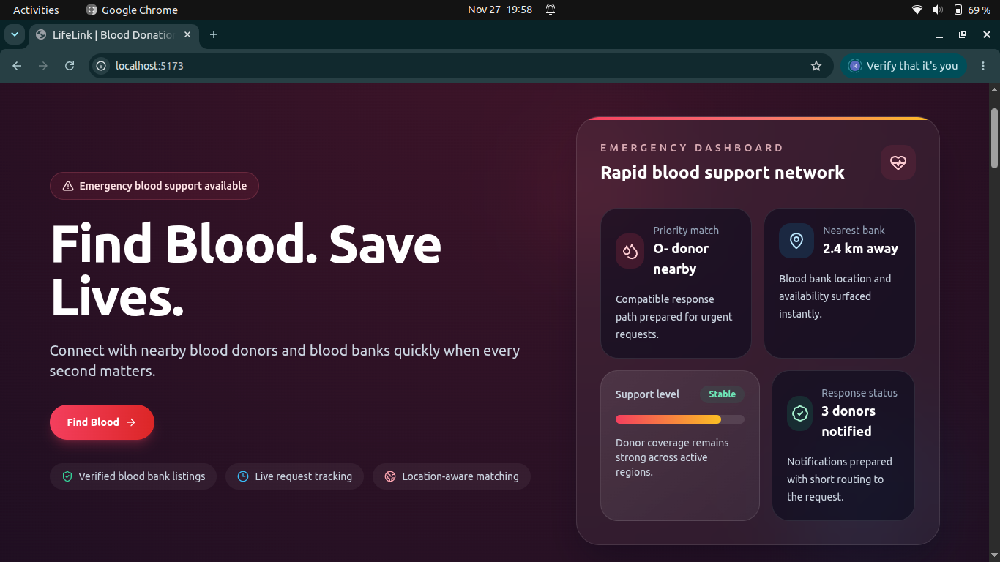
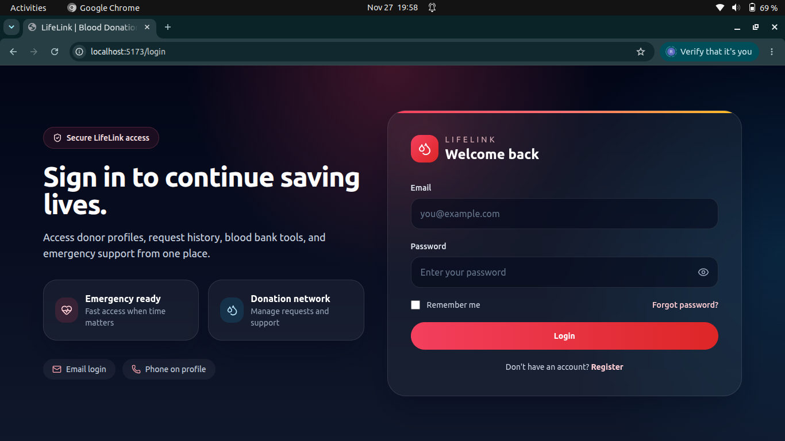
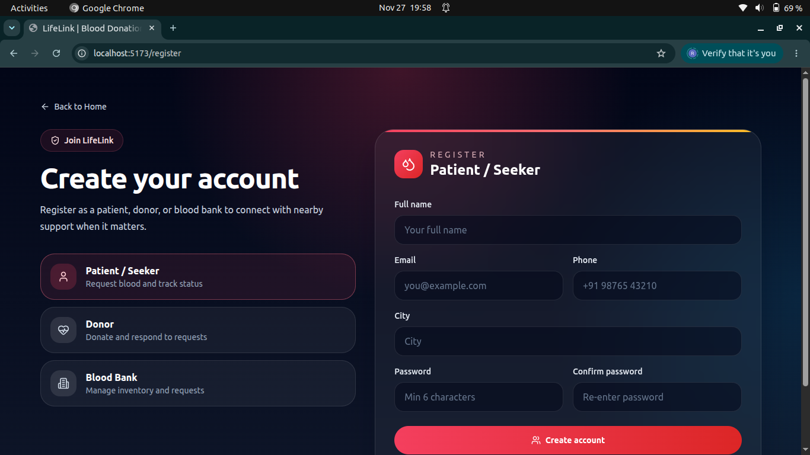
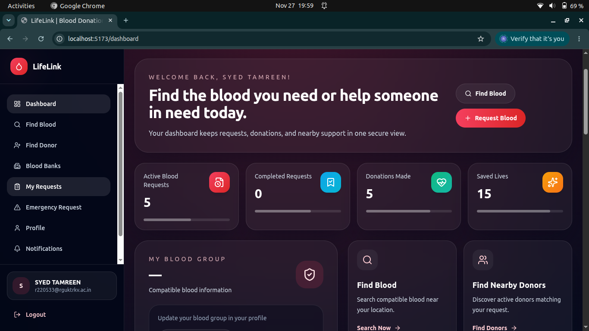
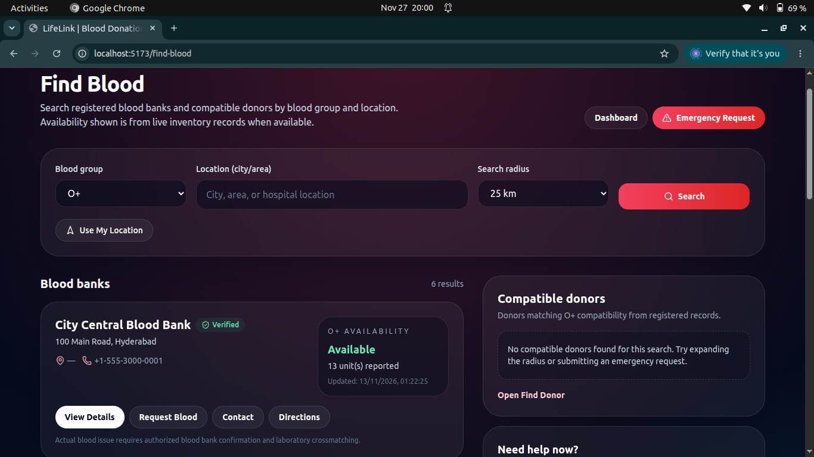
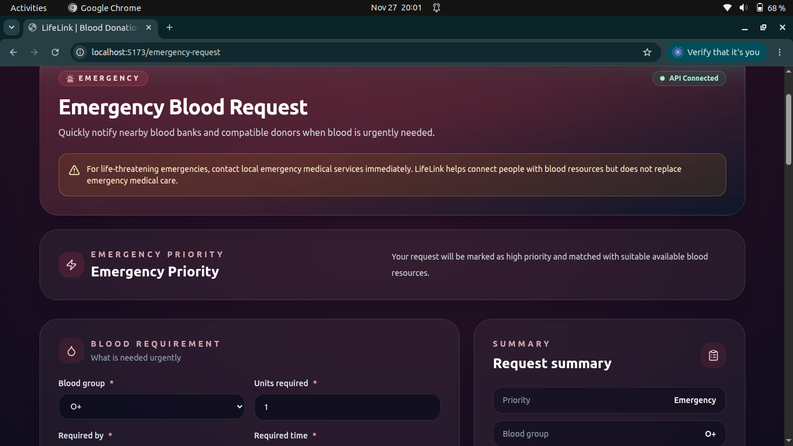
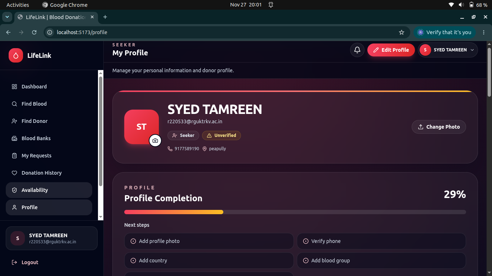
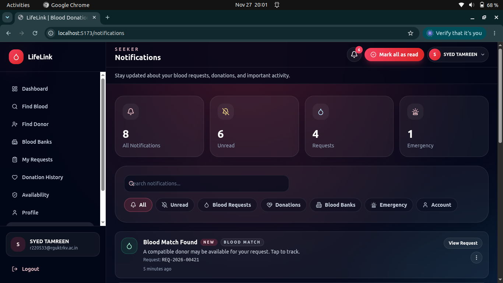

# 🩸 LifeLink --- Blood Donation & Blood Bank Finder

```{=html}
<p align="center">
```
`<strong>`{=html}Connecting Blood Donors, Saving
Lives.`</strong>`{=html} `<br/>`{=html} A smart, full-stack platform
designed to connect blood donors, people in need of blood, and blood
banks.
```{=html}
</p>
```
```{=html}
<p align="center">
```
``{=html}
``{=html}
``{=html}
``{=html}
``{=html}
```{=html}
</p>
```

------------------------------------------------------------------------

## 📌 Table of Contents

-   [About the Project](#-about-the-project)
-   [Project Objectives](#-project-objectives)
-   [Key Features](#-key-features)
-   [Screenshots](#-screenshots)
-   [Technology Stack](#-technology-stack)
-   [System Architecture](#-system-architecture)
-   [Project Structure](#-project-structure)
-   [Installation and Setup](#-installation-and-setup)
-   [Environment Configuration](#-environment-configuration)
-   [Running the Application](#-running-the-application)
-   [Testing](#-testing)
-   [Production Build](#-production-build)
-   [How It Works](#-how-it-works)
-   [Security and Safety](#-security-and-safety)
-   [Future Enhancements](#-future-enhancements)
-   [Contributing](#-contributing)
-   [Author](#-author)

------------------------------------------------------------------------

## 🌟 About the Project

**LifeLink** is a full-stack web application developed to simplify the
process of finding blood donors and blood banks during medical
emergencies.

Finding compatible blood donors at the right time can be challenging.
LifeLink aims to reduce this difficulty by providing a centralized
platform where blood seekers can search for donors and blood banks,
submit blood requests, and track their request status.

The platform supports multiple user roles, including:

-   🧑‍🦱 Blood Donors
-   ❤️ Blood Seekers
-   🏥 Blood Banks
-   🛡️ Administrators

LifeLink combines a modern React frontend with a Node.js and Express
backend, using MongoDB for data management.

**Our Mission:** Make blood donation connections easier, faster, and
more accessible through technology.

## 🎯 Project Objectives

-   Provide a centralized blood donor and blood bank finder.
-   Help users search based on blood group and location.
-   Simplify blood request creation and tracking.
-   Support donor and blood bank management.
-   Provide role-based access to different users.
-   Improve communication between blood seekers and potential donors.
-   Support better access to blood availability information.

## 🚀 Key Features

### 🧑‍🦱 1. Donor Management

-   Donor registration and login.
-   Donor profile management.
-   Blood group and location information.
-   Donor search and matching functionality.
-   Role-based donor dashboard.

### ❤️ 2. Blood Request Management

-   Create blood requests.
-   Submit emergency blood requests.
-   Track request status.
-   Manage request information.
-   Connect seekers with potential donors and blood banks.

### 🏥 3. Blood Bank Management

-   Blood bank registration and login.
-   Blood bank information management.
-   Inventory management.
-   Blood request handling.
-   Blood availability status management.

### 🔍 4. Smart Search

-   Search donors by blood group.
-   Find blood banks based on location.
-   Matching and ranking services.
-   Distance-related utility functionality.

### 🛡️ 5. Admin Management

-   Administrative dashboard.
-   Role-based access control.
-   Management of platform workflows.
-   Access to administrative endpoints and interfaces where implemented.

### 🔐 6. Authentication and Security

-   JWT-based authentication.
-   Protected API routes.
-   Role-based authorization.
-   Input validation.
-   Centralized error handling.

------------------------------------------------------------------------

## 📸 Screenshots

The following screenshots showcase the main features of the LifeLink
application. Place the corresponding image files inside
`docs/screenshots/` using the exact filenames shown below.

### 1. Home

    

### 2. Login



### 3. Register



### 4.Dashboard



### 4. Find Blood



### 5. Blood Bank


### 6. Emergency Request



### 7. Profile



### 8. Notifications



> **Note:** Add your actual screenshots to `docs/screenshots/` and make
> sure each filename matches the paths above. GitHub will display the
> images automatically when you push the README and screenshots folder
> to your repository.

  --------------------------------------------------------------------------------------------------------------------------------------------------------------------------------------------------------------------------------------------------------------------------------------------------------------------------------------------------------------------------------------------------------------------------------------------------------------------------------------------------------------------------------------------------------------------------------------------------------------------------------------------------------------------------------------------------------------------------------------------------------------------------------------------------------------------------------------------------------------------------------------------
  \## 🛠️ Technology Stack

  \| Category \| Technologies \| \|---\|---\| \| Frontend \| React.js, Vite \| \| Styling \| CSS \| \| Backend \| Node.js, Express.js \| \| Database \| MongoDB \| \| ODM \| Mongoose \| \| Authentication \| JSON Web Token (JWT) \| \| API \| REST API \| \| Testing \| Node.js Built-in Test Runner \| \| Version Control \| Git and GitHub \|

  \## 🏗️ System Architecture

  LifeLink follows a frontend-backend architecture.

  `text ┌─────────────────────────┐ │       USERS             │ │                         │ │ Donor / Seeker / Bank   │ │       / Admin           │ └────────────┬────────────┘ │ ▼ ┌─────────────────────────┐ │     REACT FRONTEND      │ │                         │ │       Vite              │ │       UI Components     │ │       Pages             │ └────────────┬────────────┘ │ ▼ ┌─────────────────────────┐ │     EXPRESS REST API    │ │                         │ │ Authentication          │ │ Controllers             │ │ Routes                  │ │ Middleware              │ │ Services                │ └────────────┬────────────┘ │ ▼ ┌─────────────────────────┐ │       MONGODB           │ │                         │ │ User Data               │ │ Blood Requests          │ │ Blood Bank Information  │ │ Inventory Data          │ └─────────────────────────┘`

  \## 📂 Project Structure

  `text LifeLink/ │ ├── backend/ │   ├── controllers/ │   ├── models/ │   ├── routes/ │   ├── middleware/ │   ├── services/ │   ├── utils/ │   ├── seed.js │   └── .env.example │ ├── frontend/ │   ├── src/ │   │   ├── components/ │   │   ├── pages/ │   │   ├── services/ │   │   └── utils/ │   ├── public/ │   └── package.json │ ├── tests/ │   ├── unit/ │   ├── integration/ │   ├── system/ │   ├── whitebox/ │   └── blackbox/ │ ├── docs/ │   └── screenshots/ │ ├── package.json └── README.md`

  \## ⚙️ Installation and Setup

  Follow these steps to run LifeLink locally.

  \### Prerequisites

  Install the following software:

  \- Node.js 18 or above (Node.js 20+ recommended). - npm. - MongoDB (local installation or MongoDB connection URI). - Git.

  \### Step 1: Clone the Repository

  `bash git clone https://github.com/Tamreen207/Blood_Donation_Finder.git`

  \### Step 2: Navigate to the Project

  `bash cd Blood_Donation_Finder`

  \### Step 3: Install Dependencies

  `bash npm install --prefix backend && npm install --prefix frontend`

  \### Step 4: Configure Environment Variables

  Create the backend `.env` file using `.env.example` and configure your database connection and authentication settings.

  \### Step 5: Start the Application

  `bash npm start`

  The application builds the frontend and starts the backend server.

  \## 🔑 Environment Configuration

  \### Backend Configuration

  Create `backend/.env`:

  `env PORT=5000 MONGO_URI=your_mongodb_connection_string JWT_SECRET=your_strong_random_secret JWT_EXPIRES_IN=7d CLIENT_ORIGIN=http://localhost:5173`

  \### Frontend Configuration

  Create `frontend/.env` if required:

  `env VITE_API_BASE_URL=http://localhost:5000`

  **Important:** Never upload `.env` files, database credentials, JWT secrets, or other sensitive information to GitHub.

  \## ▶️ Running the Application

  \### Production Mode

  `bash npm start`

  Application URL:

  http://localhost:5000

  Health Check:

  http://localhost:5000/api/health

  \### Development Mode

  Install dependencies:

  `bash npm install --prefix backend && npm install --prefix frontend`

  Start development servers:

  `bash npm run dev`

  Development URLs:

  \| Service \| URL \| \|---\|---\| \| Frontend \| http://localhost:5173 \| \| Backend API \| http://localhost:5000 \| \| API Health Check \| http://localhost:5000/api/health \|

  The Vite development server proxies API requests to the backend.

  **Database Requirement:** MongoDB must be running and correctly configured for database-dependent features.

  \## 🧪 Testing

  LifeLink includes automated testing using the Node.js built-in test runner.

  Run all test suites:

  `bash npm test`

  Individual test suites:

  `bash npm run test:unit npm run test:integration npm run test:system npm run test:whitebox npm run test:blackbox`

  \### Testing Coverage

  \| Test Type \| Purpose \| \|---\|---\| \| Unit Testing \| Tests individual functions and utilities \| \| Integration Testing \| Tests API and component interactions \| \| System Testing \| Checks project structure and required modules \| \| White-box Testing \| Tests internal logic and control flow \| \| Black-box Testing \| Validates API behavior and external responses \|

  The included test suites do not require a database. Full database-backed workflows require MongoDB and configured test accounts.

  \## 📦 Production Build

  To generate an optimized frontend production build:

  `bash npm run build`

  The generated production files are available inside:

  `text frontend/dist/`

  \## 🔄 How It Works

  1\. Users register and log in according to their role. 2. Blood seekers provide their blood group and location requirements. 3. The application searches for matching donors and blood banks. 4. Users can create and track blood requests. 5. Donors and blood banks can manage relevant requests. 6. Administrators can access administrative workflows.

  \## 🔒 Security and Safety

  LifeLink is designed with security and responsible blood donation practices in mind.

  \- JWT-based authentication and protected routes. - Role-based authorization. - Input validation and error handling. - Secure management of database credentials. - HTTPS recommended for production deployment. - Blood availability information must be verified before being presented as confirmed.

  **Medical Safety:** The application does not replace professional medical advice. Donor eligibility, blood compatibility confirmation, laboratory crossmatching, and blood issue decisions must be handled by qualified professionals and authorized blood centres.

  \## 🔮 Future Enhancements

  Potential future improvements include:

  \- Real-time notifications for blood requests. - Email and SMS alerts. - Map-based donor and blood bank discovery. - Improved emergency request workflows. - Enhanced blood inventory reporting. - More advanced analytics and dashboards. - Mobile application support.

  \## 🤝 Contributing

  Contributions and suggestions are welcome!

  1\. Fork this repository. 2. Create a new feature branch. 3. Make your changes. 4. Test your changes. 5. Commit your work. 6. Submit a pull request.

  `bash git checkout -b feature/your-feature git add . git commit -m "Add your feature" git push origin feature/your-feature`

  \## 👩‍💻 Author

  **Syed Tamreen**

  B.Tech -- Computer Science and Engineering

  Rajiv Gandhi University of Knowledge Technologies (RGUKT), RK Valley.

  \- GitHub: [@Tamreen207](https://github.com/Tamreen207) - Project Repository: [Blood_Donation_Finder](https://github.com/Tamreen207/Blood_Donation_Finder)
  --------------------------------------------------------------------------------------------------------------------------------------------------------------------------------------------------------------------------------------------------------------------------------------------------------------------------------------------------------------------------------------------------------------------------------------------------------------------------------------------------------------------------------------------------------------------------------------------------------------------------------------------------------------------------------------------------------------------------------------------------------------------------------------------------------------------------------------------------------------------------------------------

```{=html}
<p align="center">
```
`<strong>`{=html}🩸 Every Drop Counts. Every Donor Matters. Every Life
Is Precious.`</strong>`{=html} `<br/>`{=html}`<br/>`{=html} Made with ❤️
to support blood donation and help save lives.
```{=html}
</p>
```
